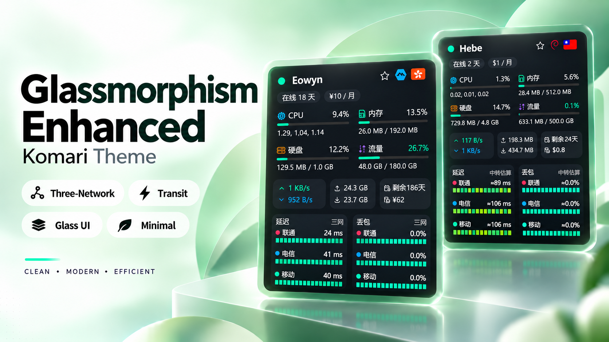

# Glassmorphism Enhanced

基于 [Komari](https://github.com/komari-monitor/komari) 的第三方监控主题。保留毛玻璃设计，重点展示节点状态、流量和中国联通／电信／移动三网延迟。

[](https://github.com/casiuna/Glassmorphism-Enhanced/releases/tag/v1.1.1)
[](LICENSE)

已完成独立 Komari 1.6.0 / 1.5.1 兼容性回归；[测试范围与限制](docs/komari-1.6.0-compatibility.md) · [迁移与回退](docs/migration-v1.1.0.md)。



## 主要功能

- **三网监控**：分别显示联通、电信、移动的延迟、丢包率和历史记录，支持多个 Ping 任务。
- **中转延迟**：可选 Transit Carrier Ping，使用 Relay 两段探测数据估算目标节点的三网质量。
- **流量展示**：按原三网主题显示流量、上行、下行与配额。
- **节点与界面**：多尺寸卡片、列表、节点详情、响应式布局、浅色／深色主题及可选地球可视化。
- **辅助工具**：节点对比、健康摘要、财务估算和 CSV／JSON 导出。
- **财务与汇率**：支持 SGD（新加坡元）等 13 种币种的费用估算与换算，支持在线汇率、缓存及手动调整。

## 安装

1. 打开 [Releases](https://github.com/casiuna/Glassmorphism-Enhanced/releases/tag/v1.1.1)，下载 **主题 ZIP 附件**（`komari-theme-Glassmorphism-build-*.zip`），不要下载 GitHub 自动生成的 Source code ZIP。
2. 在 Komari 后台的主题管理中上传、启用。
3. 按需调整三网任务、主题外观和中转规则。

不需要修改 Komari Server 或 Agent。

本版主题标识为 `Enhanced`。旧 `Glassmorphism` 安装与配置会保留，迁移与回退见 [说明](docs/migration-v1.1.0.md)。

## 三网与中转

三网直连探测使用已有 Komari Ping 任务，支持中文运营商名称及常见英文别名。若需要让目标节点显示经 Relay 的估算延迟，在主题设置 **「08 · 三网与中转延迟」** 启用 Transit Carrier Ping，并按行填写：

```text
# 中转节点|目标节点|链路任务名
RelayNode|TargetNode|Relay-Target
```

Relay 需要三网探测任务和探测目标节点的链路任务。**字段顺序固定为「中转节点｜目标节点｜链路任务」**；使用 v1.0.5 之前的旧规则时，须手动交换前两列。

中转结果是两段数据的估算值，**不是目标节点直接测得的端到端延迟**。功能默认关闭；未匹配的节点继续显示直连探测。完整规则见 [Transit 配置说明](docs/transit-rules.md)。

## 流量说明

流量使用 Komari 提供的 `net_total_up` / `net_total_down`，并按 `traffic_limit_type` 显示；不计算服务商月度账单。

## 开发

需要 Node.js `^20.19.0` 或 `>=22.12.0`，以及 Bun 1.3.14。

```bash
bun install --frozen-lockfile
bun run dev
bun run type-check
bun run build
```

更新记录见 [CHANGELOG](CHANGELOG.md)，发布流程见 [docs/releasing.md](docs/releasing.md)。

## 来源与许可

基于 [Komari Glassmorphism](https://github.com/sanrokamlan-prog/komari-theme-Glassmorphism)，三网功能参考 [Glassmorphism Three-Network](https://github.com/vlongx/komari-theme-Glassmorphism-three-network)。保留原始作者 Tokinx、上游维护者 sanrokamlan 的署名与历史，其他第三方声明见 [THIRD_PARTY.md](THIRD_PARTY.md)。

本项目采用 [MIT License](LICENSE)。

### 三网路由证据（1.1.7，本地待审）

这是 **服务器到三个固定 IPv4 骨干目标** 的出站 traceroute 证据，不是用户家庭回程测试，不代表全国、双向对称、带宽或实际业务质量。目标保持为电信 `202.97.0.1`、联通 `219.158.3.1`、移动 `211.136.88.1`。

- 三网线路按 **出发线路 → 落地线路** 两栏展示，保留原玻璃视觉与运营商点色，不表示双向。逐跳有序识别 AS4809=CN2、AS4134=163、AS9929=9929、AS4837=4837、AS58807=CMIN2、AS58453=CMI、AS9808=CMNET；正常骨干交付不再统称混合。
- 1.1.7 行布局为“运营商 | 出发 | 固定18点 | 落地 | 评价”。按最新截图反馈使用18个真实小圆点，在独立弹性列中整体居中，三行点列位置一致；常规点径3px、间距3px（整体102px），窄列按容器宽度缩小点径和间距但数量不变。运营商列按内容宽度统一对齐，并在名称后显式留出2ch间距再显示出发线路，不靠空格字符撑开。出发／落地文字不截断；评价表头留空，每行评价和 tooltip 保留。普通为黄色圆点，未知／过期 `--` 为红色圆点（仅视觉提示证据不足，不代表差线路），优秀蓝点，精品绿点；评价文字原色保持不变；字体、玻璃背景、运营商点色不变。**品质仅为骨干类型参考，不是测速、延迟／丢包、CN2 GIA 或 SLA 保证。**
- 等级规则：完整且未过期的逐跳记录中，明确 CN2／9929／CMIN2 前段为“优秀”（含 9929→163／4837、CMIN2→CMNET）；163／4837／CMI／CMNET 前段为“普通”。出发与落地同为 CN2／9929／CMIN2，且所有方法到达、结论一致、每跳都有查询 ASN、无超时／未知／前缀回退才为“精品”，只指同类骨干延伸参考。一个完整方法足以支持优秀；同前段但未完成的另一方法不否决优秀，也不能支持精品。
- 过期、stale、legacy、错误、缺完整落地、来源冲突、重入、多骨干前段、完整方法矛盾或前段矛盾均不评级（`--`＋灰点）；未知不代表差。按配置刷新间隔判断过期，过期后保留线路但撤去等级，绝不升级缓存。VMISS 历史缓存重放在有效期内三家均为优秀，当前过期时三家显示 `--`；不是新探测。
- 单跳可以证明经过该网络，但仅目的跳不证明经过骨干。落地为目标运营商最后识别骨干／国内交付网，不必等于最终接入 ASN（例如 AS56048）；只能从逐跳证据得出，不能从目标地址猜测。未到达、非零退出或末段未知时加“末段”并保留说明；无证据显示 `--`。
- 来源冲突与方法差异单独保留在 tooltip；较完整方法优先于不完整方法，同等完整结论冲突时不任选主标签；网络重入／交替保留有序路径。所有方法、未知跳、真实 ASN 与到达状态均可在 tooltip 查看。CN2 不推断 GIA，也不表示全国、家庭接入、对称或 SLA。线路参考等级与 Ping 质量模块完全独立。
- 回归包含只读公开缓存的单节点六组真实记录及合成顺序／重入／未知／来源与协议冲突样例；缓存不是本轮新执行的探测。
- 按顺序保存每跳 IP、ASN（含重复）、未知/超时、查询或有限前缀来源、冲突、每次方法/退出码/到达状态。tooltip 展示证据及有效时间/最近尝试。只有部分跳被识别时不称“完整路径”。有限 IPv4 前缀只是启发式补充，不是实时 BGP 数据库；没有覆盖 IPv6。
- 每家执行 ICMP 和 UDP 两个固定有界尝试，即使 ICMP 返回 0 也进行 UDP，以处理“成功退出但全星/无证据”。支持 `-A` 时优先查询，失败后不带 `-A` 再试；没有 ASN 时只使用有限精确边界前缀。每次远端 `timeout -k 2 32`（plain 26 秒），总远端最坏约 380 秒，前端采集等待 420 秒，每个 HTTP 请求 15 秒。客户端停止等待不等于取消远端；远端由固定 timeout 收尾。
- 依赖兼容 Komari authenticated task exec/result、theme settings API、节点启用远程命令、`traceroute` 和支持 `-k` 的 `timeout`。缺工具不暗中安装；仅管理员明确启用自动安装时先执行独立安装任务（root、apt/apk/dnf/yum），再采集。安装与采集预算分离。无 `timeout` 时安全失败，不尝试无界安装。
- 逐家保存 lastAttempt/lastSuccess/error/stale；失败保留该家的上次有效证据，同时记录最新失败尝试。旧版去重缓存不冒充完整证据，标记待刷新；过期缓存挂载时刷新。保存失败仍保留本浏览器内存中的结果并显示错误。
- 同一浏览器通过共享保存队列，在发送前读最新设置并合并节点增量，避免卡片互相覆盖。**多浏览器/其他设置编辑仍可能竞态**：后端没有 CAS/逐节点原子接口，主题不能彻底解决。结果/设置保持现有公共设置存储语义，避免写入凭据。

本地无网络测试：`node node_modules/@playwright/test/cli.js test -c tests/route-probe.config.ts`。升级上传 ZIP 后需由管理员重新探测；本地构建不代表已部署或已验证真实节点。
